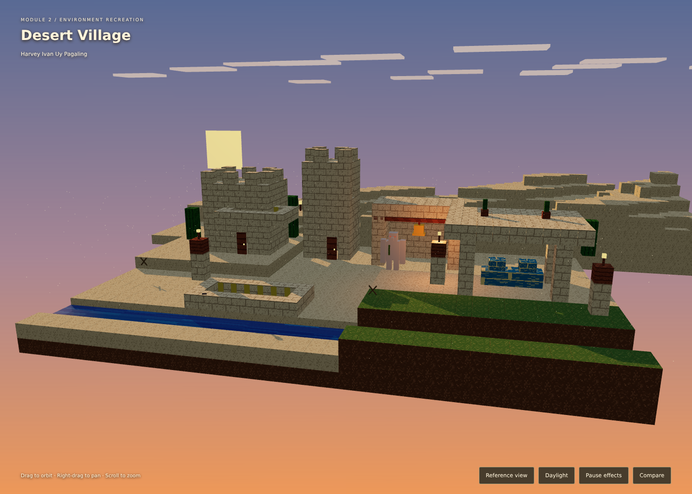
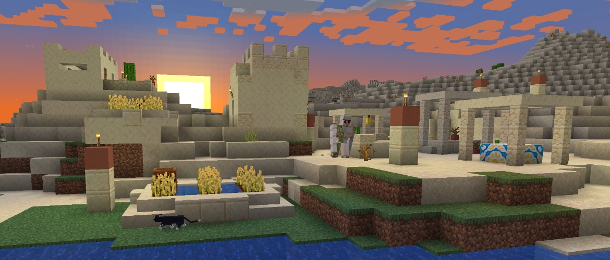

# M2 PA - PAGALING

**Minecraft: Desert Village at Sunset**

Harvey Ivan Uy Pagaling

## Reference

This project recreates the main forms and palette of the official Minecraft desert village screenshot accompanying [Building Blocks: Village](https://www.minecraft.net/pt-br/article/village), by Duncan Geere, published August 1, 2024.

Reference image copyright belongs to Mojang / Microsoft. The image is included only for educational comparison. Game geometry and textures are not extracted. All scene geometry and texture maps are built locally in JavaScript.

## Run

Use VS Code Live Server, or run `python -m http.server 8000` in this folder and visit http://localhost:8000. On Windows, `py -m http.server 8000` also works. Requires HTTP for ES modules and a WebGL 2-capable browser. Three.js 0.186.1 is included locally with its MIT license. No npm install or CDN is needed.

## Controls

- Drag: orbit the camera.
- Right-drag or Shift-drag: pan.
- Scroll: zoom.
- Reference view: restore the initial camera.
- Daylight / Sunset: switch lighting and sky.
- Pause / Resume effects: control animation.
- Compare: show the reference beside a capture of the current scene.

## Requirements

| Requirement | Implementation |
| --- | --- |
| Recreate a game scene | Sandstone towers, central bell shelter, market, irrigated farm, stream, terraces, desert hills, square sun and clouds |
| Geometries | BoxGeometry for voxel objects and characters; PlaneGeometry for wheat; BufferGeometry for dust particles |
| Materials | MeshLambertMaterial, MeshPhongMaterial, MeshStandardMaterial, MeshBasicMaterial, PointsMaterial |
| Different lighting | HemisphereLight, shadow-casting DirectionalLight, warm PointLight |
| Different textures | Eight procedural pixel maps: sand, sandstone, dirt, grass, acacia planks, cactus, water, market cloth |
| Animations | Torch flicker, bell motion, drifting clouds, gentle water motion and dust |
| Particles | Fixed pool of 450 drifting dust particles with boundary wrapping |
| Scene viewing controls | Custom pointer orbit/pan and wheel zoom |
| Maximum five imported objects | Zero imported 3D models. Golem and cat are assembled from boxes |
| Code quality | External modules, organized css/js/vendor/reference folders, named functions and comments |

This is a simplified reconstruction rather than an exact copy. Block placement, crops and character details differ from the reference. The lighting matches a stylized sunset, with a daylight mode for inspection.

## Validation

Browser checks passed for 5,621 instanced blocks, 450 particles remaining active and bounded after 600 simulated seconds, material and texture types, three light types, camera orbit/reset, lighting mode, pause/resume, comparison image capture, and full-screen resizing at 1400×1000 and 390×844. No JavaScript errors or failed resource requests occurred.

## Files

- index.html: canvas, controls and comparison dialog
- css/style.css: full-screen responsive interface
- js/main.js: scene construction, lights, camera interaction and animation
- js/textures.js: deterministic procedural pixel textures
- vendor/three/: local Three.js modules and license
- reference/minecraft-village.jpg: official comparison image
- preview.png: actual rendered output

## Attribution

[Reference screenshot](https://www.minecraft.net/content/dam/minecraftnet/games/minecraft/screenshots/village-header.jpg), Minecraft.net. Minecraft belongs to Mojang / Microsoft. This educational project is unofficial and is not affiliated with or endorsed by them.

Three.js: [mrdoob/three.js](https://github.com/mrdoob/three.js), MIT license included.
